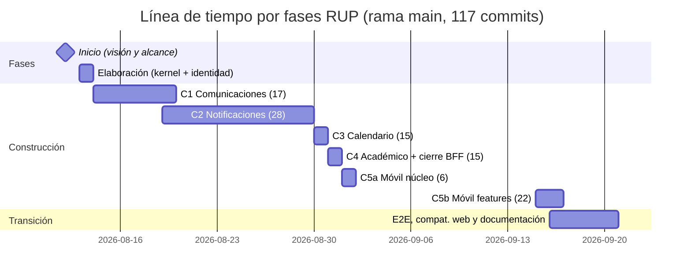

# Metodología — RUP adaptado al proyecto UNIMARapp

> Tesis de Ingeniería de Sistemas — Universidad de Margarita (UNIMAR)
> Metodología declarada: **Proceso Unificado de Rational (RUP)**, adaptado a un contexto de tesis individual.
> Decisión arquitectónica *dentro* de RUP: **desarrollo basado en componentes** (CBSE/DSBC).
> Disciplina interna de cada componente: **Clean Architecture**.

Este documento explica (1) qué es RUP y cómo se ha adaptado, (2) cómo encaja la
arquitectura basada en componentes como práctica de RUP, (3) la línea de tiempo
real del desarrollo reconstruida desde el historial git con fases e iteraciones
identificables, y (4) la correspondencia entre fases RUP y artefactos del repo.

---

## 1. Metodología declarada: RUP

RUP es un proceso de desarrollo de software **dirigido por casos de uso,
centrado en la arquitectura, e iterativo-incremental**, organizado en cuatro
fases con duración y objetivo definidos (Jacobson, Booch y Rumbaugh, 1999;
Kruchten, 2003):

| Fase | Propósito | Hito que la cierra |
|---|---|---|
| **Inicio** (Inception) | Definir alcance y visión; justificar el proyecto | Visión y alcance estabilizados |
| **Elaboración** (Elaboration) | Establecer la arquitectura del sistema con una base **ejecutable**; atacar los riesgos mayores | Arquitectura basal validada |
| **Construcción** (Construction) | Construir incrementalmente el producto sobre la arquitectura basal, iteración tras iteración | Beta del producto |
| **Transición** (Transition) | Verificación final, correcciones, despliegue y transferencia | Producto en producción |

Dos rasgos son esenciales para este proyecto:

1. **Cada fase contiene disciplinas de todas las actividades** (requerimientos,
   diseño, implementación, pruebas): RUP no es cascada. Lo que cambia entre
   fases es el *énfasis*.
2. **Las iteraciones de Construcción se planifican sobre la arquitectura**: cada
   iteración toma un conjunto de casos de uso y entrega incrementos verificables
   que se integran al sistema existente.

Entre las mejores prácticas que RUP recomienda (Kruchten, 2003) figura
explícitamente **«construir basándose en componentes»** (*develop components*):
sistema compuesto por módulos con interfaces bien definidas y reutilizables.
Esta práctica es la puerta de entrada del paradigma CBSE/DSBC al proceso.

## 2. Adaptación de RUP al contexto de tesis

RUP se definió para equipos con roles especializados; una tesis individual
requiere una adaptación declarada y honesta:

| Elemento de RUP | Adaptación en este proyecto |
|---|---|
| Roles (analista, diseñador, implementador, verificador) | Los cuatro roles los ejerce el mismo autor, secuencialmente, dentro de cada iteración |
| Iteraciones orientadas a release | Iteraciones orientadas a **componente** (una por módulo de negocio), cada una con su mini-ciclo completo |
| Dirigido por casos de uso | Los casos de uso del dominio se materializan **un archivo por caso de uso** en `application/` (40 casos de uso en total: identidad 2, comunicaciones 15, notificaciones 11, calendario 6, académico 6) |
| Arquitectura centrada | `ARCHITECTURE.md` como documento rector desde el primer commit + **arquitectura basal ejecutable** en Elaboración |
| Pruebas por disciplina | Unitarias por caso de uso + integración de políticas RLS por repositorio + verificación E2E en Transición |
| Disciplinas de gestión | Gestión ligera: historial git como registro de configuración; documentación viva en `docs/` |

La adaptación no altera ni elimina ninguna fase canónica de RUP: solo colapsa
roles (equipo unipersonal) y orienta las iteraciones de Construcción por
componentes en lugar de por entregables parciales de producto.

## 3. El basado en componentes como práctica RUP (por qué DSBC no se descarta)

La arquitectura del proyecto adopta el paradigma **Component-Based Software
Engineering** (Heineman y Councill, 2001), conocido internamente como DSBC.
Dentro de este trabajo metodológico, DSBC **no es la metodología de proceso:
es la decisión arquitectónica que materializa la práctica RUP «construir
basándose en componentes»**. Sus tres principios, con evidencia verificable:

1. **Encapsulamiento** — cada componente (módulo de negocio) vive en
   `src/modules/<módulo>/` con capas internas (`domain`, `application`,
   `infrastructure`, `http`) invisibles para el exterior.
2. **Contratos por interfaces** — 15 puertos declarados en los dominios
   (`ports.ts`); un archivo `index.ts` por módulo como única puerta de entrada
   (p. ej. `identidad/index.ts` publica 8 símbolos); contratos de wire con
   esquemas Zod en la frontera HTTP; comunicación inter-módulos por bus de
   eventos (`shared/kernel/eventos.ts`).
3. **Independencia** — construcción, verificación, despliegue y sustitución por
   separado (mock ↔ real por inyección de dependencias; pruebas aisladas por
   componente; proveedores push intercambiables por configuración).

La disciplina interna de cada componente corresponde a **Clean Architecture**
(Martin, 2017): la Regla de Dependencia hace que las dependencias apunten hacia
el dominio, lo que garantiza estructuralmente que los contratos de los
componentes se cumplan (el proyecto no compila si se violan).

### Relación de los tres niveles

| Nivel | Qué aporta | Dónde se verifica |
|---|---|---|
| **RUP** (proceso) | Fases, iteraciones, énfasis de disciplinas | Matriz de §5 y línea de tiempo de §4 |
| **CBSE/DSBC** (arquitectura) | Fronteras entre componentes, contratos, eventos | `src/modules/`, `index.ts`, puertos |
| **Clean Architecture** (disciplina interna) | Capas y Regla de Dependencia dentro de cada componente | Las 4 subcarpetas idénticas por módulo |

## 4. Línea de tiempo real del desarrollo (evidencia git)

Rama única `main`, 117 commits entre 2026-08-12 y 2026-09-20 (85 en agosto,
32 en septiembre). La distribución por fases se reconstruyó a partir de los
umbrales temporales de los commits; los hashes permiten auditar cada bloque
(comandos en §7).



*(las iteraciones se solapan levemente: C2 inicia el mismo día en que cierra
C1 — típico de RUP, donde varias disciplinas avanzan en paralelo y el énfasis
va cambiando de un componente al siguiente).*

### 4.1 Tabla de bloques con hashes de auditoría

| Bloque | Fecha | Commits (rango inclusivo) | Contenido verificable |
|---|---|---|---|
| **Inicio** | 2026-08-12 | 1 — `2ddf47e` | `.gitignore` + `ARCHITECTURE.md`: alcance del BFF, stack, decisiones de seguridad (RBAC+ABAC) y visión de componentes. La arquitectura quedó definida **antes** de todo código de negocio. |
| **Elaboración** | 2026-08-13 | 7 — `2ddf47e..cfa10fd` | Bootstrap y CLI de Supabase (`96ea0e3`, `450b4f4`); *shared kernel* ejecutable (unitOfWork con claims, JWT, bus de errores) `fcdbf55`; **primer componente vertical completo**: identidad con puertos + mock + login `a012cc0`; Express `be44950`; pruebas unitarias y RLS `24aabc8`; documentación `cfa10fd`. Arquitectura basal validada por un caso de punta a punta. |
| **C1 — Comunicaciones** | 08-14 → 08-19 | 17 — `2201037^..a76175d` | Migración BD `2201037` → dominio + puertos `6d13577` → **15 casos de uso** `c02cfd1` → repos Postgres + Supabase Storage `aefb370`, `c2941c5` → schemas + rutas `dbbd068`, `8101c93` → registro en composition root `420a1bc` → pruebas caso de uso + RLS `e694545..e1d760b` → docs `a76175d`. |
| **C2 — Notificaciones** | 08-19 → 08-29 | 28 — `5bd1245^..725a0fb` | DB `5bd1245` → API + dominio + repos `25ccf3a..e6c8d05` → **bus de eventos** `83ec035` + hooks de Comunicaciones dentro de transacciones `3775108` → fan-out aprobado/rechazado `e32653e` → push (Expo/Mock) `15c1556` → pruebas unit+RLS `7c86ed8..c8d17c2` → **verificación E2E documentada** `725a0fb`. Cierra la notificación como servicio integrado y verificado. |
| **C3 — Calendario** | 2026-08-30 | 15 — `162f038^..ccff0c7` | Ciclo completo en un día: migración + dominio + casos + http + RLS (17:14→18:43); correcciones de frontera para mantener el módulo contenido (re-export vía shared kernel, sin importar externos) `f8b4fb7..ccff0c7`. |
| **C4 — Académico + cierre del BFF** | 2026-08-31 | 15 — `aabd49a^..15c78f4` | Caché LRU para la API UNIMAR `aabd49a` → puertos y DTOs `f555794` → mock + rutas + casos de uso + API pública `4fd7790..741f6ed` → API-key sistema-a-sistema + fan-out de notas `be8eb7a..caf2f1a` → wiring final `db7ddc2` → tests sistema + RLS `cb5d522` → update de `ARCHITECTURE.md` `15c78f4`. **Cierre arquitectónico del backend**, fase beta del BFF. |
| *(soporte a la siguiente iteración)* | 08-31 23:18 → 09-01 00:11 | 4 — `660f2af`, `66a11ea`, `79d3da9`, `9bcbac2` | `docs/onboarding-frontend.md` (contrato API para el cliente), guía de diseño (`STYLE.md`), reorganización de `ARCHITECTURE.md`. **Artefactos de hand-off producidos por el BFF para la iteración móvil** (en RUP: traspaso entre iteraciones). |
| **C5a — Móvil: núcleo** | 2026-09-01 | 6 — `d911998^..2b2e168` | Esqueleto Expo + flujo auth + clientes HTTP + push `d911998`; registro de dispositivos en backend `c10c629..2b2e168`. El móvil **reutiliza los contratos ya publicados por el BFF** (no reescribe reglas). |
| **C5b — Móvil: features** | 09-15 → 09-16 | 22 — `e1edef8^..04ac82d` | Bandeja, comunicados (+markdown, adjuntos, estadísticas), calendario, académico, historial médico restringido — un commit por feature `2282180..f9efa9c`, iterándose contra el wire real (fixes de contratos: `e1edef8`, `c4df357`). |
| **Transición** | 09-16 → 09-20 | 2 — `eabde27`, `dbe68d3` | Compatibilidad web del móvil `04ac82d` (última corrección de build), runbook de dispositivo físico WSL2 `eabde27`, `AGENTS.md` (transferencia del conocimiento del repo) `dbe68d3`. |

Suma por fase: Inicio 1, Elaboración 7, Construcción 107 (5 iteraciones + 4 de
soporte), Transición 2 → **117 commits** totales (línea base `dbe68d3`).

### 4.2 El patrón iterativo dentro de cada componente

Cada iteración de Construcción repite el mismo mini-ciclo — visible en las
fechas y orden de los mensajes de commit — que corresponde al ciclo de
disciplinas de RUP aplicado al componente:

```
diseño/construcción BD → dominio+puertos → casos de uso → infraestructura
→ contratos HTTP (Zod+rutas) → composición en el BFF → pruebas (unit+RLS)
→ documentación estable
```

Ejemplo auditable: C1 (Comunicaciones, ago 14–19) ejecuta este patrón en 17
commits (ver §4.1). El mismo patrón reaparece en C2, C3, C4 y C5 — la
consistencia del patrón es la evidencia de que el proceso se aplicó
sistemáticamente, no de forma puntual.

### 4.3 Indicadores del período

| Métrica | Valor |
|---|---|
| Commits totales / rama | 117 / `main` (línea base `dbe68d3`) |
| Commits en Construcción | 107 (91 %) — típico del énfasis RUP |
| Componentes entregados en Construcción | 5 backend + 2 iteraciones de móvil |
| Casos de uso materializados | 40 (1 archivo por caso de uso en `application/`) |
| Puertos de dominio (contratos) | 15 interfaces `I*` |
| Archivos de prueba | 16 en módulos + 5 en `shared/` (unit + integración RLS) |

## 5. Matriz de correspondencia fase RUP ↔ artefactos

| Fase RUP | Actividades aplicadas | Artefacto verificable (hash) |
|---|---|---|
| **Inicio** | Caso de negocio, alcance (BFF + móvil), riesgos (API UNIMAR inexistente), stack | `ARCHITECTURE.md` en `2ddf47e` |
| **Elaboración** | Casos de uso de nivel sistema; arquitectura basal: kernel compartido, seguridad, primer componente de identidad; valida el patrón end-to-end | `fcdbf55` (kernel), `a012cc0` (identidad), `24aabc8` (tests) |
| **Construcción** | 7 iteraciones, una (o dos) por módulo; cada una deja el sistema integrable; casos de uso, un archivo por caso; DIP para alternar mocks↔reales | `2201037^..15c78f4` (BFF), `d911998^..04ac82d` (móvil) |
| **Transición** | Verificación E2E, corrección multiplataforma (web), documentación de despliegue y transferencia | `725a0fb`, `04ac82d`, `eabde27`, `dbe68d3` |

## 6. Ciclo RUP siguiente (fases futuras)

La fecha de cierre de las iteraciones no cierra el proceso: RUP es repetible por
ciclo. El ciclo `v2` ya tiene alcance abierto, mapeado sobre la misma
estructura de fases:

| Fase v2 | Alcance previsto | Mecanismo preparado |
|---|---|---|
| **Elaboración (v2)** | Sustituir el mock por la API real de UNIMAR | El contrato `IUniversityAuthService` y el flujo por DIP ya permite cambiar la implementación sin tocar dominio ni cliente |
| **Construcción (v2)** | Publicar push real (dev build EAS); iteraciones nuevas de módulos si la universidad añade servicios | `PUSH_PROVIDER=expo` ya soportado; un nuevo módulo = nueva carpeta en `modules/` sin tocar las demás |
| **Transición (v2)** | Despliegue del BFF y de la app con build producido | Documentación de runbooks ya existente (`docs/guia-expo-go.md`, `docs/e2e-notificaciones.md`) |

## 7. Cómo auditar esta matriz (transparencia metodológica)

Los comandos siguientes reproducen los datos citados (ejecutar dentro del repo):

```bash
# Linea de tiempo completa con hashes y fechas
git log --reverse --date=format:'%Y-%m-%d %H:%M' --pretty='format:%h|%ad|%s'

# Conteo de commits por bloque (rango inclusivo = A^..B)
git rev-list --count 2ddf47e..cfa10fd     # Elaboración          = 7
git rev-list --count 2201037^..a76175d    # C1 Comunicaciones     = 17
git rev-list --count 5bd1245^..725a0fb    # C2 Notificaciones     = 28
git rev-list --count 162f038^..ccff0c7    # C3 Calendario         = 15
git rev-list --count aabd49a^..15c78f4    # C4 Académico          = 15
git rev-list --count d911998^..2b2e168    # C5a Móvil núcleo      = 6
git rev-list --count e1edef8^..04ac82d    # C5b Móvil features    = 22

# Conteos de la fase de desarrollo verificables en el código
find src/modules/*/application -name '*.ts' ! -name '*.test.ts' | wc -l  #   = 40
grep -rh "interface I" src/modules/*/domain src/shared/kernel | wc -l     #  = 15
find src -name '*.test.ts' | wc -l                                        #  = 21
```

## 8. Nota de honestidad metodológica (para el jurado)

- RUP **es** el marco del proceso; las fases de este trabajo son canónicas y
  sus adaptaciones (roles unipersonales, iteración por componente) están
  declaradas en §2, no ocultas.
- «DSBC» es la denominación local de la práctica arquitectónica del
  paradigma CBSE: en esta tesis se presenta como **decisión de diseño dentro
  de la mejor práctica RUP «desarrollar componentes»**, con Clean Architecture
  como disciplina interna de implementación de cada componente. La evaluación
  metodológica del trabajo se hace contra las fases y artefactos RUP (§4–§7).
- Las referencias citadas están todas en la bibliografía académica estándar
  (véase «Referencias»); los datos del §4 provienen del repositorio y son
  replicables con los comandos del §7.

## Referencias

- Jacobson, I., Booch, G., & Rumbaugh, J. (1999). *The Unified Software
  Development Process*. Addison-Wesley.
- Kruchten, P. (2003). *The Rational Unified Process: An Introduction*
  (3.ª ed.). Addison-Wesley.
- Heineman, G. T., & Councill, W. T. (2001). *Component-Based Software
  Engineering: Putting the Pieces Together*. Addison-Wesley.
- Szyperski, C. (1998). *Component Software: Beyond Object-Oriented
  Programming*. Addison-Wesley.
- Martin, R. C. (2017). *Clean Architecture: A Craftsman's Guide to Software
  Structure and Design*. Prentice Hall.
- Sommerville, I. (2011). *Ingeniería de Software* (9.ª ed.). Pearson
  (capítulo sobre CBSE/arquitecturas por componentes).
